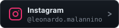

<h3><code>leonardo@github ~ $ ./contributions.sh</code></h3>

 
 

<h3><code>leonardo@github ~ $ whoami</code></h3>

<table>
  <tr>
    <td valign="top"></td>
    <td valign="top"></td>
  </tr>
</table>

 
 

<h3><code>leonardo@github ~ $ ./about.sh</code></h3>

<strong>Full-Stack Developer &amp; Web Experience Designer</strong>

Full-stack developer, handling everything from planning, implementing and maintaining software. I have experience with web development, database design and implementation, animations, and much more.

 
 

<h3><code>leonardo@github ~ $ ./tech-stack.sh</code></h3>

<h4>Tools &amp; Deployment</h4>

  
  
  
  
  
  
  
  
  

<h4>Frontend</h4>

  
  
  
  
  
  
  

<h4>Backend &amp; Databases</h4>

  
  
  
  
  
  
  

<h4>Animations &amp; 3D</h4>

  
  
  
  

 
 

<h3><code>leonardo@github ~ $ ./connect.sh</code></h3>

I'd love to collaborate, chat about web development, or discuss cool project ideas!

  
  
  

 

